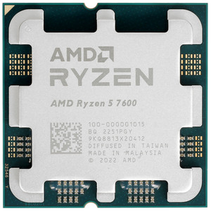
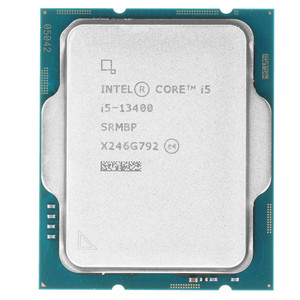
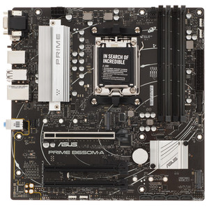
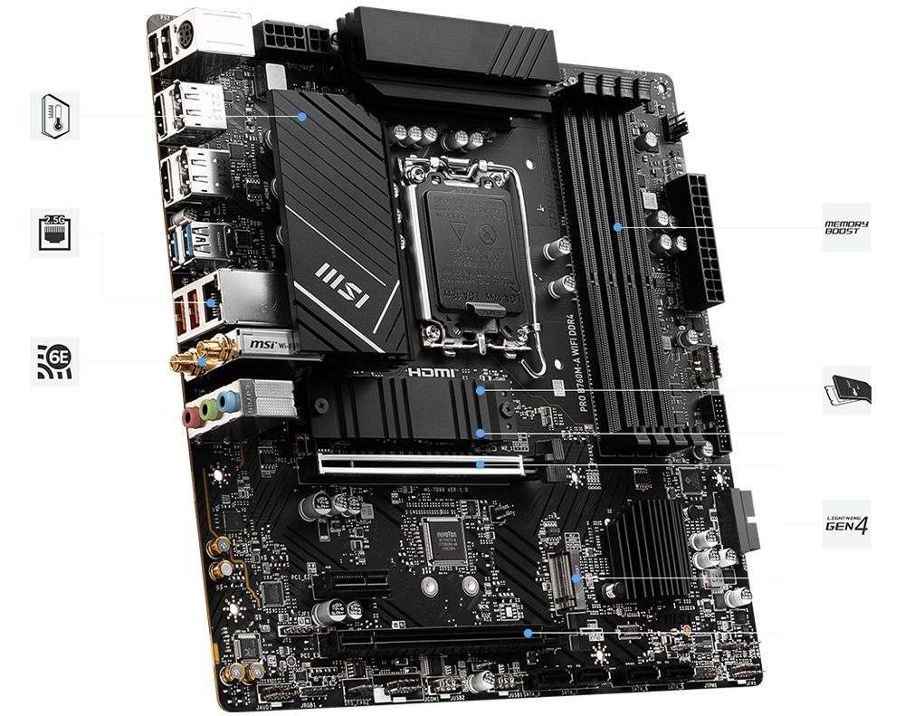
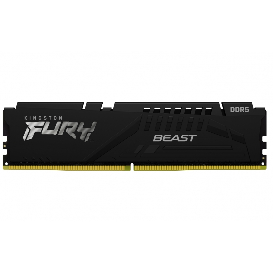
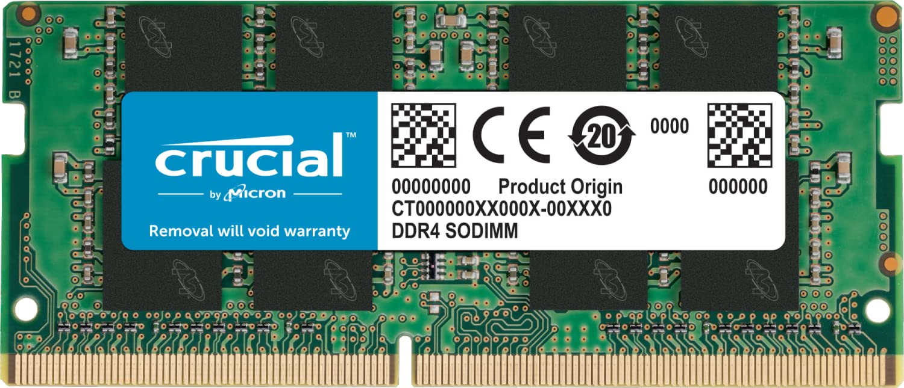
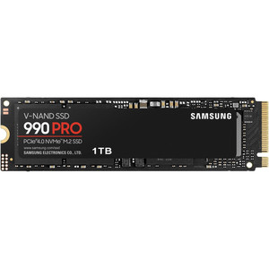
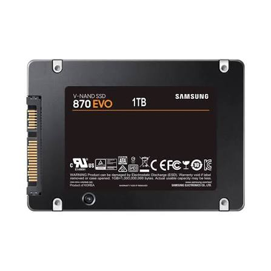
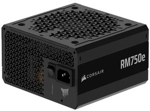
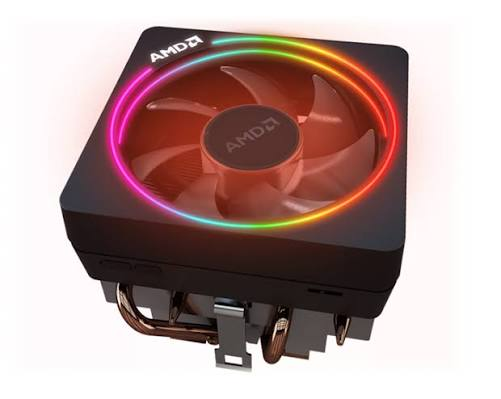

# Lab 3 — Teardown, and the same machine from the command line

Pair: Nursaya Ibraeva   Driver first half: Nursaya
Machine: <host: Lenovo IdeaPad Slim 5 16IRL8, Windows 11>, <guest: Ubuntu Server 26.04.1 LTS in VirtualBox (VM `lab01-ubuntu`)>
Date: 08.11.2026
### 1. AMD Ryzen 5 7600

**What it is:** desktop CPU, 6 cores / 12 threads, Zen 4, 65 W TDP, with integrated Radeon graphics.
**Connects to:** socket AM5 (LGA1718), dual-channel DDR5, PCIe 5.0.
**Limit:** AM5 boards and DDR5 only; it does not fit AM4 boards and cannot use DDR4. Ships with the AMD Wraith Stealth cooler.
Maker page: <https://www.amd.com/en/products/processors/desktops/ryzen/7000-series/amd-ryzen-5-7600.html>

### 2. Intel Core i5-13400

**What it is:** desktop CPU, 10 cores (6 Performance + 4 Efficient) / 16 threads, Raptor Lake, 65 W base power, integrated UHD Graphics 730.
**Connects to:** socket LGA1700 on 600- and 700-series chipsets; dual-channel memory, DDR4-3200 or DDR5-4800 depending on the board.
**Limit:** LGA1700 boards only (not LGA1200, not AMD). The board decides whether it runs DDR4 or DDR5; the two types cannot be mixed. The retail box includes an Intel Laminar RM1 cooler.
Maker page: <https://www.intel.com/content/www/us/en/products/sku/230495/intel-core-i513400-processor-20m-cache-up-to-4-60-ghz/specifications.html>

### 3. ASUS PRIME B650M-A

**What it is:** Micro-ATX motherboard, chipset AMD B650, socket AM5.
**Connects to:** the CPU, up to 4 DDR5 DIMMs, PCIe 4.0 expansion cards, M.2 NVMe SSDs, SATA drives, and the PSU through 24-pin ATX and 8-pin EPS cables. It has display outputs for the CPU's integrated graphics.
**Limit:** Ryzen 7000, 8000 and 9000 desktop CPUs only; DDR5 only; no Intel CPUs and no DDR4.
Maker page: <https://www.asus.com/motherboards-components/motherboards/prime/prime-b650m-a/>

### 4. MSI PRO B760M-A WIFI DDR4

**What it is:** Micro-ATX motherboard, chipset Intel B760, socket LGA1700.
**Connects to:** the CPU, up to 4 DDR4 DIMMs (128 GB max), PCIe 4.0 slots, two M.2 slots, 4 SATA 6 Gb/s ports, HDMI/DisplayPort for integrated graphics.
**Limit:** Intel Core 12th, 13th and 14th gen, Pentium Gold and Celeron only; DDR4 only (a DDR5 module is keyed out of the slot); no AMD CPUs.
Maker page: <https://www.msi.com/Motherboard/PRO-B760M-A-WIFI-DDR4>

### 5. Kingston FURY Beast DDR5-5600, 16 GB (KF556C40BB-16)

**What it is:** 288-pin DDR5 unbuffered DIMM, 16 GB, rated 5600 MT/s, CL40, 1.25 V at the rated profile.
**Connects to:** a DDR5 DIMM slot, one module per slot.
**Limit:** does not fit DDR4 slots (different key notch and pin layout). The default speed stored on the module (SPD) is the JEDEC DDR5-4800; 5600 MT/s is an Intel XMP 3.0 profile, so a board may run it at 4800 until the profile is enabled in BIOS.
Maker page: <https://www.kingston.com/en/memory/gaming/kingston-fury-beast-ddr5-memory>

### 6. Crucial DDR4-3200, 16 GB DIMM

**What it is:** 288-pin DDR4 unbuffered DIMM, 16 GB, 3200 MT/s, 1.2 V.
**Connects to:** a desktop DDR4 DIMM slot, one channel per populated slot.
**Limit:** does not fit DDR5 slots or laptop SO-DIMM slots. 3200 MT/s equals the i5-13400's official DDR4 limit, so it runs at its rated speed on that CPU.
Maker page: <https://www.crucial.com/memory/ddr4/ct16g4dfra32a>

### 7. Samsung 990 PRO 1 TB

**What it is:** M.2 2280 NVMe 2.0 SSD on a PCIe 4.0 x4 interface.
**Connects to:** an M-key M.2 slot with PCIe support, directly to the board.
**Limit:** needs a PCIe M.2 slot (a SATA-only M.2 slot will not work and it does not fit 2.5" bays); on a PCIe 3.0 slot it works but at lower bandwidth.
Maker page: <https://www.samsung.com/uk/memory-storage/nvme-ssd/990-pro-1tb-nvme-pcie-gen-4-mz-v9p1t0bw/>

### 8. Samsung 870 EVO 1 TB

**What it is:** 2.5" SATA III SSD.
**Connects to:** a SATA port through a 7-pin data cable, and to the PSU through a 15-pin SATA power connector; it sits in a 2.5" drive bay.
**Limit:** the SATA III interface (6 Gb/s) caps sequential speed at about 560 MB/s whatever the flash can do; it cannot be fitted in an M.2 slot.
Maker page: <https://www.samsung.com/kz_ru/memory-storage/sata-ssd/870-evo-1tb-sata-3-2-5-ssd-mz-77e1t0bw/>

### 9. Corsair RM750e (750 W)

**What it is:** fully modular ATX power supply, 750 W, 80 PLUS Gold.
**Connects to:** wall AC input; modular cables carry power to the 24-pin ATX board connector, 8-pin EPS CPU connector, PCIe connectors for a graphics card and SATA power for drives.
**Limit:** 750 W total, and the standard ATX size has to fit the case. Both builds below draw far less, so the limit is headroom, not a problem.
Maker page: <https://www.corsair.com/ww/ru/p/psu/cp-9020248-ww/rme-series-rm750e-fully-modular-low-noise-atx-power-supply-cp-9020248-ww>

### 10. Stock cooler: AMD Wraith Stealth (and Intel Laminar RM1)

**What it is:** low-profile air cooler with pre-applied thermal paste and a 4-pin PWM fan.
**Connects to:** the CPU socket's mounting (AM5 retention frame) and the board's CPU_FAN header.
**Which processor ships with one:** the Ryzen 5 7600 includes the Wraith Stealth; the Core i5-13400 retail box includes an Intel Laminar RM1 (see the Intel page in item 2).
**Limit:** sized for 65 W CPUs at stock settings; each cooler is built for its own socket, so the Wraith Stealth does not mount on LGA1700 and the Laminar RM1 does not mount on AM5 without a different bracket.
Maker page: <https://www.amd.com/en/products/processors/desktops/ryzen/7000-series/amd-ryzen-5-7600.html>

---

## Part 2 — The two motherboards

| | ASUS PRIME B650M-A | MSI PRO B760M-A WIFI DDR4 |
|---|---|---|
| Socket | AM5 | LGA1700 |
| Chipset | AMD B650 | Intel B760 |
| Memory type | DDR5 (4 slots) | DDR4 (4 slots, 128 GB max) |
| CPU generations accepted | Ryzen 7000, 8000, 9000 | Intel Core 12th, 13th, 14th gen; Pentium Gold; Celeron |
| Ryzen 5 7600 (Zen 4, 7000 series) | accepted | rejected (wrong socket) |
| Core i5-13400 (13th gen) | rejected (wrong socket) | accepted |

---

## Part 3 — Two computers on paper

### Build A: AMD AM5 with DDR5

| Part | Model | Why it fits here |
| :--- | :--- | :--- |
| CPU | AMD Ryzen 5 7600 | A 7000-series CPU is on the ASUS board's CPU support list and uses socket AM5. |
| Motherboard | ASUS PRIME B650M-A | The only AM5 board in the list; its DDR5 slots match the CPU's memory controller. |
| Memory | Kingston FURY Beast DDR5-5600 16 GB | AM5 supports only DDR5, so the DDR4 Crucial module cannot be used here. |
| Storage | Samsung 990 PRO 1 TB | The board's M.2 slot is PCIe 4.0, which is what the 990 PRO needs to reach full speed. |
| PSU | Corsair RM750e (750 W) | Provides the 24-pin and 8-pin EPS connectors; 750 W is far above what a 65 W CPU build draws. |
| Cooler | AMD Wraith Stealth | Included with the 7600 and fits the AM5 mounting. |

Still needed: a Micro-ATX case, an operating system, and a second 16 GB DDR5 module (one stick runs single-channel; two matching sticks give dual-channel). A graphics card is optional because the Ryzen 5 7600 has integrated graphics and the board has display outputs.

### Build B: Intel LGA1700 with DDR4

| Part | Model | Why it fits here |
| :--- | :--- | :--- |
| CPU | Intel Core i5-13400 | A 13th-gen CPU is on the MSI board's CPU support list and uses socket LGA1700. |
| Motherboard | MSI PRO B760M-A WIFI DDR4 | The only LGA1700 board in the list; it takes DDR4, which the i5-13400 supports. |
| Memory | Crucial DDR4-3200 16 GB | The board has only DDR4 slots, and 3200 MT/s is the CPU's official DDR4 maximum. |
| Storage | Samsung 870 EVO 1 TB | The board has 4 SATA 6 Gb/s ports, which match the drive's SATA III interface. |
| PSU | a second power supply (not in the parts list) | The only RM750e is assigned to Build A. A 450–550 W unit is a reasonable estimate for a build with no discrete GPU. |
| Cooler | Intel Laminar RM1 | Included with the i5-13400 and fits the LGA1700 holes. |

Still needed: a Micro-ATX case, a power supply, an operating system, a SATA data cable for the 870 EVO, and a second 16 GB DDR4 module for dual-channel. A graphics card is optional because the i5-13400 has integrated UHD 730 graphics and the board has HDMI/DisplayPort outputs.

Combinations that were checked and rejected: Kingston DDR5 in Build B (DDR4 slots), Crucial DDR4 in Build A (AM5 has no DDR4), Ryzen 5 7600 on the MSI board (wrong socket), Core i5-13400 on the ASUS board (wrong socket).

---

## Part 4 — The same facts from the command line

Windows output is from my laptop (the host). Linux output is from the Ubuntu Server VM `lab01-ubuntu`, so it describes the **virtual machine** (2 vCPU, 4 GB RAM, 25 GB disk), not the physical hardware. No Mac is available, so the table covers two operating systems.

### The commands

| Fact | Windows (PowerShell) | Linux (Ubuntu Server, VM) |
|---|---|---|
| CPU model | `Get-CimInstance Win32_Processor \| Select Name` | `lscpu` (Model name) |
| Cores / threads | `Get-CimInstance Win32_Processor \| Select NumberOfCores,NumberOfLogicalProcessors` | `lscpu` (Core(s) per socket, Thread(s) per core, CPU(s)) |
| Total memory | `Get-CimInstance Win32_PhysicalMemory \| Select Capacity` (sum of modules) | `free -h` |
| Memory modules, type, speed | `Get-CimInstance Win32_PhysicalMemory \| Select DeviceLocator,Capacity,Speed,ConfiguredClockSpeed,SMBIOSMemoryType,FormFactor` | `sudo dmidecode -t memory` |
| Disk model, type | `Get-PhysicalDisk \| Select FriendlyName,MediaType,BusType,Size` | `lsblk -o NAME,MODEL,ROTA,TRAN,SIZE` |
| Free space | `Get-Volume C` | `df -h /` |
| Architecture | `$env:PROCESSOR_ARCHITECTURE` | `uname -m` |

### The results

| Fact | Windows (host laptop) | Linux (VM) |
|---|---|---|
| CPU model | 13th Gen Intel Core i7-13620H | 13th Gen Intel Core i7-13620H (as seen by the guest) |
| Cores / threads | 10 cores / 16 logical processors | 2 vCPU: 2 cores per socket, 1 thread per core |
| Total memory | 16 GB | 3.3 GiB visible of the 4 GB assigned |
| Memory modules, speed | 2 × 8 GB Samsung LPDDR5 (SMBIOS type 35), one per channel; rated 6400, configured 5200 | no module records: `dmidecode` prints only the SMBIOS header |
| Disk | SKHynix_HFS512GEJ4X112N, SSD, NVMe, 512 GB | VBOX HARDDISK, 25 GB, SATA, `ROTA=1` |
| Free space | 191.2 GB free of 509.7 GB | 17 GB free of 23 GB (root volume) |
| Architecture | AMD64 | x86_64 |

Raw outputs: [windows-specs.txt](evidence/windows-specs.txt), [linux-specs.txt](evidence/linux-specs.txt).

### Where the names and values differ

- **Cores and threads.** The i7-13620H has 6 Performance and 4 Efficient cores, so 10 cores give 16 logical processors. Windows calls them `NumberOfLogicalProcessors`; Linux shows CPUs and "Thread(s) per core". The VM was given only 2 vCPUs, so Linux sees a much smaller machine.
- **Two memory speeds on Windows.** `Speed` (6400) is the rated speed of the modules and `ConfiguredClockSpeed` (5200) is the speed they actually run at.
- **Memory type.** Windows reports `SMBIOSMemoryType 35` (LPDDR5) with the locations `Controller0-ChannelA` and `Controller1-ChannelA`, so the memory is soldered on the board. Inside the VM, `dmidecode` shows no memory modules at all.
- **Disk type.** Windows reports `MediaType SSD` and `BusType NVMe`. The VM reports `ROTA=1` (rotational, like an HDD) and `TRAN sata`, because it sees a virtual disk, not the NVMe drive underneath.
- **The VM sees the CPU but not the hardware around it.** Linux shows the laptop's CPU model but also `Hypervisor vendor: KVM` and `Virtualization type: full`, so the guest knows it is virtual.

---

## What did not work the first time

- I ran the Windows commands in PowerShell opened in `C:\WINDOWS\system32`, so `windows-specs.txt` was created there instead of in my repository, and `git add .` failed with "not a git repository" because I had not cloned the repository. I created the file again on the Desktop and uploaded it to the `evidence` folder on GitHub.
- For the Linux file I added a port forwarding rule in the NAT Network (`2222` to `10.0.2.5:22`) and connected with `ssh`. The first connection worked, but `scp` then failed with "Connection reset by 127.0.0.1" and "Connection refused". <what you did: for example, you started the VM again and checked the rule, or you saved the `cat` output in Notepad as UTF-8>.

## Evidence

- [evidence/photos/](evidence/photos/) — the makers' photos of all ten parts
- [evidence/windows-specs.txt](evidence/windows-specs.txt) — PowerShell commands and output on the host
- [evidence/linux-specs.txt](evidence/linux-specs.txt) — `lscpu`, `free -h`, `dmidecode`, `lsblk`, `df -h`, `uname -m` inside the VM

