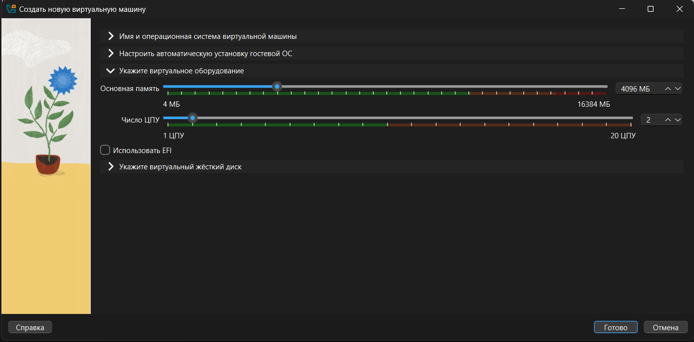
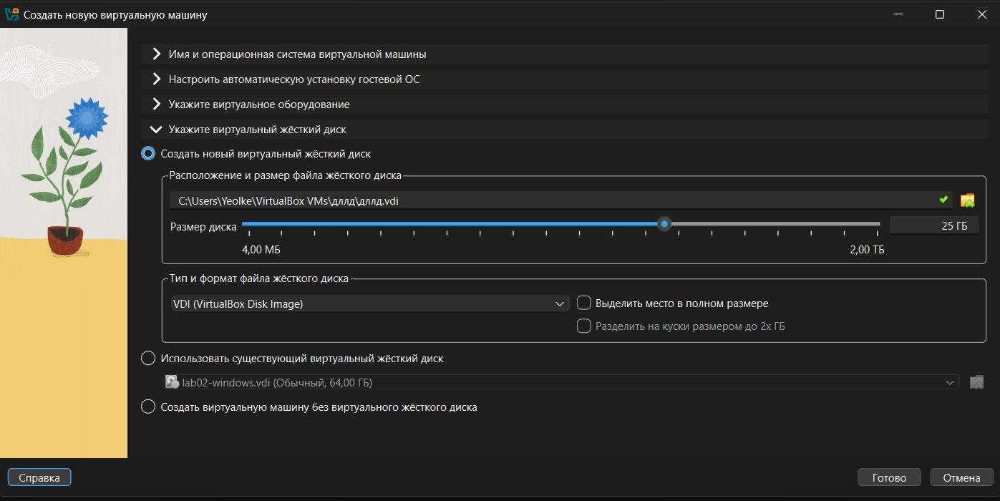
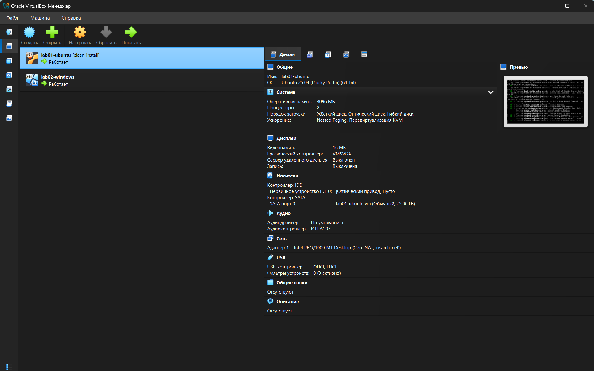
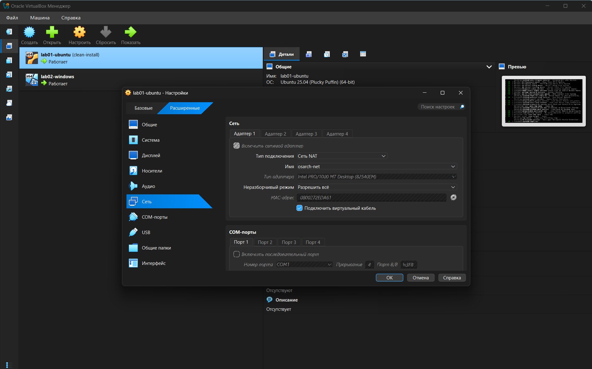
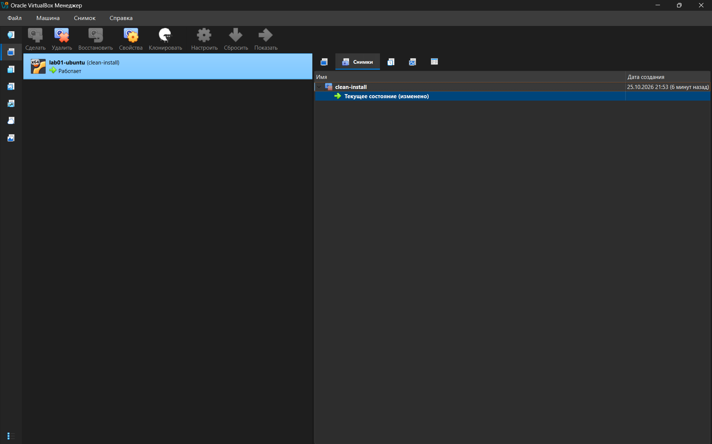
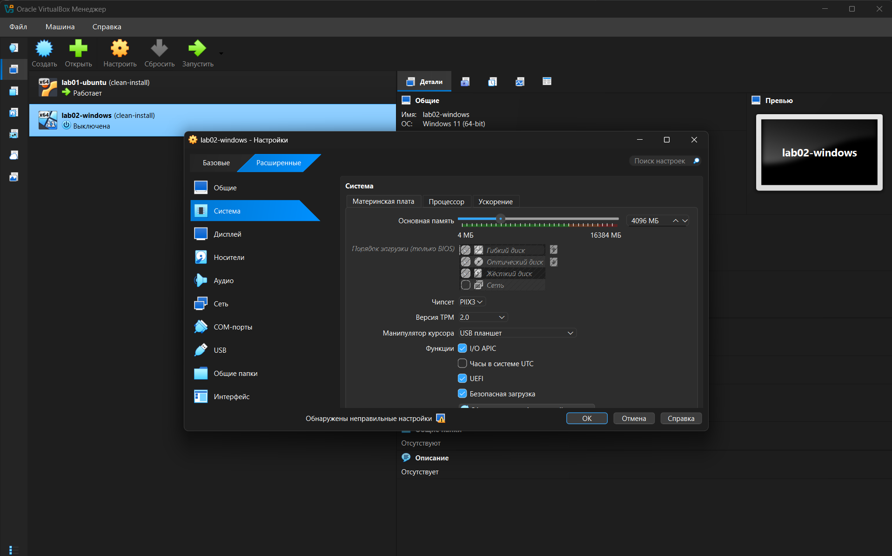
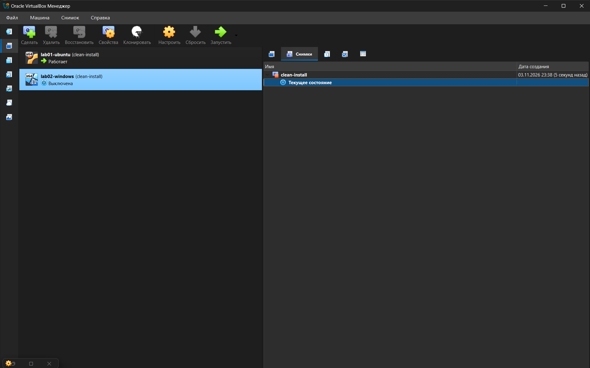
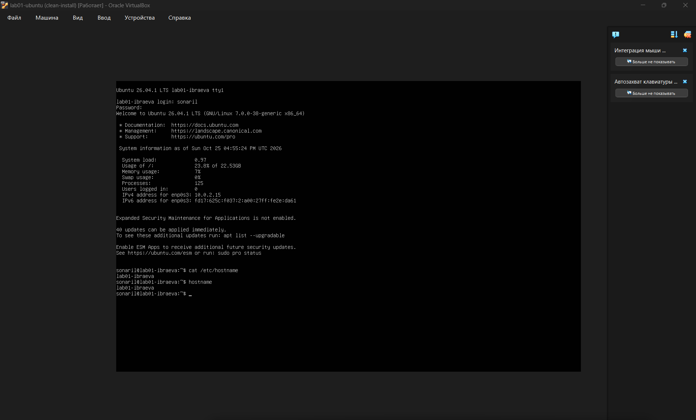

# How to build a test machine: one Linux guest and one Windows guest

This document lets you rebuild two virtual machines (a "test computer inside your computer") from nothing. You do not need to have used a hypervisor before. Follow the steps in order, and do not skip the **Check** lines: each one tells you whether the step worked before you go on.

A virtual machine (VM) is a pretend computer that runs in a window on your real one (the *host*). If you break it, you can roll it back with a *snapshot*, so your real computer is never at risk. That is what "try things without breaking anything" needs.

---

## Part 0. Before you start

### Step 0.1. Check the host
You need a computer with **at least 16 GB of RAM** and about **100 GB of free disk space**. Open *Task Manager → Performance* and read the memory and disk figures.

Why 16 GB: the two guests below take 4 GB each, and the host needs the rest. When the guests were given 10 GB each on a 16 GB host, only 3 GB stayed free, about 2 GB was pushed out to swap, and both guests became too slow to use. **Rule of thumb: all guests together get no more than half of the host's RAM.**

> Check: Task Manager shows 16 GB or more installed, and the drive that will hold the VMs has at least 100 GB free (25 GB Linux disk + 64 GB Windows disk, plus a margin).

### Step 0.2. Make sure virtualisation is on
In *Task Manager → Performance → CPU*, the line "Virtualization" must say **Enabled**. If it says *Disabled*, switch on Intel VT-x or AMD-V in the BIOS/UEFI settings of your computer and restart.

Why: without it VirtualBox cannot start 64-bit guests.

### Step 0.3. Install VirtualBox
Download VirtualBox (this guide used version **7.2.20**) and install it with the default options.

Why VirtualBox: it is free for this use (see https://www.virtualbox.org/wiki/Licensing_FAQ) and runs on Windows.

> Check: VirtualBox opens and shows an empty list of machines.

### Step 0.4. Create the shared network
Both guests must be on one virtual network, so they can see each other and still reach the internet. In VirtualBox open *File → Tools → Network Manager*, go to the **NAT Networks** tab and click **Create**. Name it `osarch-net` and keep the default range (`10.0.2.0/24`).

Why a **NAT Network** and not plain *NAT*: plain NAT gives every guest the internet but hides it from the other guests. A NAT Network gives both. Why not *Bridged*: a bridged guest shows up on your real network as a separate device, and many office and campus networks refuse unknown devices.

> Check: the network `osarch-net` appears in the list.

---

## Part 1. The Linux guest (Ubuntu Server)

### Step 1.1. Create the machine
Click **New** and set:
- Name: `lab01-ubuntu`
- ISO: Ubuntu Server 26.04.1 LTS (`ubuntu-26.04.1-live-server-amd64`)
- Memory: **4096 MB**
- Processors: **2**
- Disk: **25 GB**, dynamically allocated
- **Use EFI**: leave it **unticked** (plain BIOS). Ubuntu Server does not need UEFI here; the Windows guest in Part 2 does.

Why these numbers: a server with no desktop runs well on 2 processors and 4 GB, and this leaves room for the Windows guest. A dynamic disk only takes space on your drive as it fills, so it does not claim 25 GB at once.

> Check: the summary lists 2 CPUs, 4096 MB and a 25 GB disk.







### Step 1.2. Put it on the shared network
*Settings → Network → Adapter 1 → Attached to: NAT Network*, and choose the network from Step 0.4.

> Check: the adapter shows the name of the NAT Network.



### Step 1.3. Install Ubuntu
Start the VM and follow the installer. The choices that matter:
- Storage: **Use an entire disk**. This is the empty virtual disk, so nothing on your real disk is touched.
- **Install OpenSSH server**: tick it. It lets you copy text out of the VM later.
- Featured server snaps: **select none**. Nothing here is needed for a test machine.

> Check: after the restart you can log in at the text prompt.

### Step 1.4. Give the machine a name
```
sudo hostnamectl set-hostname lab01-ibraeva
```
Why: a name you chose shows at once which machine you are typing into.

> Check: `hostname` prints `lab01-ibraeva`.

### Step 1.5. Use the whole disk
The installer used only about half of the disk (`df -h /` showed about 11 GB). Grow it:
```
sudo lvextend -r -l +100%FREE /dev/mapper/ubuntu--vg-ubuntu--lv
```
**Mind the space** between `+100%FREE` and `/dev/...`. Without it the command fails with `Specified %FREE/dev/mapper/ubuntu--vg-ubuntu--lv is unknown`. This happened on the first attempt.

> Check: `df -h /` now shows about 23 GB.

Now save the system information (the file must contain each command and its output):
```
uname -a
lsb_release -a
hostname
df -h /
```
Put them in `evidence/04-guest-uname.txt`, which starts with the line `# Proves: ...` (see the file in the evidence folder).

### Step 1.6. Take the clean snapshot
Shut the machine down properly:
```
sudo poweroff
```
Then, with the VM **powered off**, open the VM's *Snapshots* tab and click **Take**. Name it `clean-install`.

Why powered off: nothing is half-written, so the snapshot is small and consistent.

> Check: the Snapshots panel lists `clean-install`.



---

## Part 2. The Windows guest

### Step 2.1. Get Windows
Download **Windows 11 Enterprise (evaluation)** from the Microsoft Evaluation Center: https://www.microsoft.com/en-us/evalcenter/evaluate-windows-11-enterprise

Why the evaluation edition: it is a legal, free copy for testing. It works for about 90 days, after which it starts shutting down by itself; for a test machine you can rebuild or roll back, that is acceptable.

### Step 2.2. Create the machine
Click **New** and set:
- Name: `lab02-windows`
- Memory: **4096 MB**, Processors: **2**
- Disk: **64 GB**, dynamically allocated
- Turn on **EFI**, **Secure Boot** and the **TPM** (a virtual TPM 2.0)

Why: Windows 11 will not install without UEFI, Secure Boot and a TPM; the installer stops and says the PC cannot run Windows 11. 64 GB is the Windows 11 minimum disk size and 4 GB the minimum memory.

> Check: the machine's settings show EFI enabled and a TPM.



### Step 2.3. Put it on the same network
*Settings → Network → Adapter 1 → Attached to: NAT Network*, the **same** network as the Linux guest.

### Step 2.4. If the screen stays black
On the first start the window may stay black at a small 640x480 size and nothing happens. The cause is the virtual graphics card, not the machine.
Fix: switch the VM off, open *Settings → Display → Screen → Graphics Controller*, choose **VMSVGA**, and start the VM again. Windows Setup appears.

### Step 2.5. Install Windows
Start the VM and follow Windows Setup: choose language and keyboard, click *Install now*, choose **I don't have a product key**, edition **Windows 11 Enterprise (Evaluation)**, accept the licence, choose **Custom: Install Windows only**, select the empty drive (Drive 0, Unallocated Space) and continue. Windows restarts several times; do not press a key at the "Press any key to boot from CD or DVD" prompt again. Finish the setup screens with a local account.

> Check: you reach the Windows desktop.

### Step 2.6. If a VM shows "Aborted" or "Inaccessible"
Never delete a VM while it is running. If you did, VirtualBox keeps a broken entry (status *Aborted*, disk `lab02-windows.vdi` *Inaccessible*, error `VERR_FILE_NOT_FOUND`) because the disk file is already gone.
Fix: remove the broken entry from the list and create the VM again with Step 2.2.
Prevention: switch the VM off first, then use *Remove*.

### Step 2.7. Take the clean snapshot
With the Windows VM switched off, open its *Snapshots* tab, click **Take** and name it `clean-install`.

> Check: the Snapshots panel of the Windows VM lists `clean-install`.



---

## Part 3. Make the two guests see each other

### Step 3.1. Read each guest's address
- Linux: `ip addr` (look for `10.0.2.x`).
- Windows, in Command Prompt: `ipconfig` (look for *IPv4 Address*).

In this build Linux had `10.0.2.5` and Windows `10.0.2.3`.

> Check: both addresses are in `10.0.2.0/24` and they are different.

### Step 3.2. Ping in both directions
From Linux: `ping -c 4 10.0.2.3`. From Windows: `ping 10.0.2.5`.

**Linux to Windows times out the first time.** Windows Firewall blocks incoming ping by default; the network is fine. Fix it in a PowerShell window opened with *Run as administrator*:
```
New-NetFirewallRule -DisplayName "Allow ping in (ICMPv4)" -Protocol ICMPv4 -IcmpType 8 -Direction Inbound -Action Allow
```
Why this and not switching the firewall off: it opens only ping and leaves the rest of the firewall working.

> Check: both directions return replies with 0% loss.

### Step 3.3. Check the internet from each guest
On both guests: `ping 1.1.1.1` (Linux: `ping -c 4 1.1.1.1`), then `ping google.com`.

Why two tests: the first proves the connection, the second proves name lookup (DNS). If only the second fails, the problem is name lookup, not the connection.

> Check: replies from both guests.

Save everything from Steps 3.1 to 3.3, each command followed by its output, in `evidence/05-ping-between-guests.txt`.

---

## Part 4. Roll back (the "try without breaking" part)

### Step 4.1. Break something on purpose
In the Linux guest:
```
sudo rm /etc/hostname
```
Restart the guest. `hostname` now shows the name from the installer, not the one you chose, and `cat /etc/hostname` fails.

### Step 4.2. Go back to the snapshot
Switch the VM off, open *Snapshots*, select `clean-install` and click **Restore**. Start the VM again.

> Check: `hostname` prints `lab01-ibraeva` again.



---

## Part 5. If something goes wrong

- The VM will not start and says virtualisation is not available: switch on VT-x / AMD-V in the BIOS/UEFI (Step 0.2).
- The screen stays black at 640x480: Step 2.4.
- A VM shows "Inaccessible": Step 2.6.
- No internet in a guest: check that the adapter is on the NAT Network and that the cable is shown as connected.
- Ping to Windows times out: Step 3.2.
- Everything is slow: the guests together take more than half of the host's RAM (Step 0.1).
